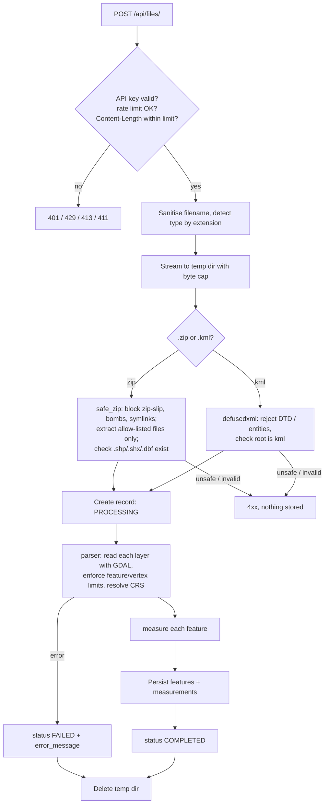
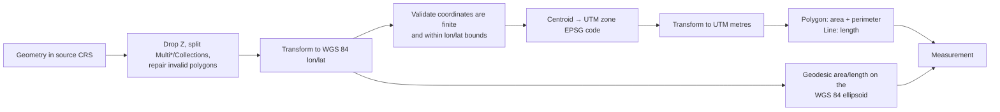

# Geospatial File Measurement API

[](https://github.com/kane378/aereo-assignment/actions)

A backend service (FastAPI) that accepts a **Shapefile (.zip)** or a **KML** file, extracts every feature,
and returns **area** for polygons and **length** for lines, calculated in a proper projected coordinate
system instead of raw latitude/longitude degrees.

I chose the engineering assignment: **Geospatial File Measurement API**.

## Highlights

- **Correct measurements.** Each feature is re-projected to the UTM zone that contains it before measuring.
  An independent *geodesic* (ellipsoidal) value is returned alongside, as a cross-check.
- **Handles real-world messy data:** multi-layer files, MultiPolygons, polygons with holes, 3D (altitude)
  coordinates, self-intersecting polygons (auto-repaired), empty geometries, Shapefiles with no `.prj`, and
  files already in a projected CRS such as Web Mercator.
- **Never crashes on unsupported input.** Points and unsupported geometries return a status and a note.
- **Security-minded.** Zip-slip, zip-bomb, XXE and upload-size protections, API-key auth, rate limiting,
  security headers, a hardened container, and tests that simulate each attack. See [Security](#security).
- **Tested.** 91 tests (~95% coverage), linted with Ruff, scanned with Bandit and `pip-audit`, all run in GitHub Actions CI.

---

## Setup

Requires **Python 3.11+**. No system GDAL install is needed (the wheels bundle GDAL/GEOS/PROJ).

### Option 1: run locally

```bash
git clone https://github.com/kane378/aereo-assignment.git
cd aereo-assignment

python -m venv .venv
source .venv/bin/activate          # Windows: .venv\Scripts\activate

pip install -r requirements.txt
cp .env.example .env               # optional: Windows: copy .env.example .env

uvicorn app.main:create_app --factory --reload
```

Open **http://127.0.0.1:8000/docs** for the interactive Swagger UI.

### Option 2: Docker

```bash
docker compose up --build
```

The service listens on port 8000. Data persists in a named volume.

### Try it with the included sample data

```bash
curl -X POST http://127.0.0.1:8000/api/files/ -F "file=@sample_data/hyderabad_survey.kml"
curl -X POST http://127.0.0.1:8000/api/files/ -F "file=@sample_data/hyderabad_parcels_utm.zip"
```

### Run the tests

```bash
pip install -r requirements-dev.txt
pytest --cov=app
ruff check . && bandit -r app -ll
```

### Configuration

All settings are environment variables (or a `.env` file). See [`.env.example`](.env.example).

| Variable | Default | Purpose |
|---|---|---|
| `API_KEYS` | *(empty)* | Comma-separated keys. When set, every `/api/*` call needs an `X-API-Key` header. Empty disables auth (local dev only). |
| `DATABASE_URL` | `sqlite:///./data/geo_measure.db` | Any SQLAlchemy URL. |
| `MAX_UPLOAD_MB` | `25` | Maximum upload size. |
| `MAX_UNZIPPED_MB` / `MAX_ZIP_ENTRIES` / `MAX_COMPRESSION_RATIO` | `200` / `200` / `200` | Zip-bomb limits. |
| `MAX_FEATURES` / `MAX_VERTICES` | `50000` / `5000000` | Processing limits. |
| `RATE_LIMIT_PER_MINUTE` / `UPLOAD_RATE_LIMIT_PER_MINUTE` | `120` / `10` | Per-IP limits (`0` = off). |
| `ENABLE_DOCS` | `true` | Set `false` in production to hide Swagger/OpenAPI. |
| `ALLOWED_HOSTS` / `CORS_ORIGINS` | `*` / *(none)* | Host-header allow-list and CORS origins. |

---

## API

If `API_KEYS` is set, add `-H "X-API-Key: <your key>"` to every request below.

| Method | Endpoint | Description |
|---|---|---|
| `POST` | `/api/files/` | Upload and process a `.zip` (Shapefile) or `.kml` |
| `GET` | `/api/files/{id}/` | File information and processing status |
| `GET` | `/api/files/{id}/measurements/` | Area/length per feature, with totals and pagination |
| `GET` | `/api/files/{id}/features/` | Full features: geometry (GeoJSON), CRS, properties, measurements |
| `GET` | `/api/files/` | List uploaded files |
| `DELETE` | `/api/files/{id}/` | Delete a file and its features |
| `GET` | `/health` | Liveness probe |

### `POST /api/files/`

Multipart form fields:

- `file` (required): a `.zip` containing a Shapefile, or a `.kml`.
- `assume_crs` (optional): e.g. `EPSG:4326`. Used only if the file has no CRS (a Shapefile without `.prj`).

```bash
curl -X POST http://127.0.0.1:8000/api/files/ -F "file=@sample_data/hyderabad_survey.kml"
```

`201 Created`

```json
{
  "id": "e9769aa9-67cb-4bd6-99ca-9d7f4f5ce068",
  "filename": "hyderabad_survey.kml",
  "file_type": "kml",
  "size_bytes": 1507,
  "status": "COMPLETED",
  "crs": "EPSG:4326",
  "feature_count": 6,
  "geometry_summary": { "Polygon": 3, "LineString": 1, "Point": 2 },
  "error_message": null,
  "created_at": "2026-10-12T03:48:45.939187Z",
  "completed_at": "2026-10-12T03:48:45.974589Z"
}
```

**Error behaviour**

| Situation | Response |
|---|---|
| Not a `.zip`/`.kml`, empty file, bad `assume_crs` | `415` / `400` |
| Upload larger than the limit | `413` (`411` if no `Content-Length`) |
| Malicious archive/XML (zip-slip, zip bomb, XXE) | `422`, nothing stored |
| Zip with no `.shp`, or missing `.shx`/`.dbf` | `400` |
| Valid file that can't be processed (no CRS, corrupt, too many features) | `201` with `"status": "FAILED"` and an `error_message` |
| Missing/invalid API key | `401` |
| Too many requests | `429` with `Retry-After` |

### `GET /api/files/{id}/`

```json
{
  "id": "b1589aad-bcfa-43d0-9b42-fd51041b08f6",
  "filename": "hyderabad_parcels_utm.zip",
  "file_type": "shapefile",
  "size_bytes": 2034,
  "status": "COMPLETED",
  "crs": "EPSG:32644",
  "feature_count": 4,
  "geometry_summary": { "LineString": 1, "Polygon": 3 },
  "error_message": null
}
```

### `GET /api/files/{id}/measurements/?limit=100&offset=0`

```json
{
  "file_id": "e9769aa9-67cb-4bd6-99ca-9d7f4f5ce068",
  "summary": {
    "total_features": 6,
    "measured": 4,
    "not_applicable": 2,
    "unsupported": 0,
    "total_area_sq_m": 250000.924,
    "total_length_m": 8872.9866
  },
  "pagination": { "limit": 100, "offset": 0, "total": 6 },
  "measurements": [
    {
      "feature_index": 0,
      "layer": "Hyderabad Site Survey",
      "geometry_type": "Polygon",
      "status": "MEASURED",
      "area_sq_m": 100000.482,
      "area_hectares": 10.000048,
      "perimeter_m": 1299.9985,
      "length_m": null,
      "geodesic_area_sq_m": 99884.7316,
      "geodesic_length_m": null,
      "projected_crs": "EPSG:32644",
      "note": null
    },
    {
      "feature_index": 3,
      "layer": "Hyderabad Site Survey",
      "geometry_type": "LineString",
      "status": "MEASURED",
      "area_sq_m": null,
      "length_m": 8872.9866,
      "geodesic_length_m": 8868.0981,
      "projected_crs": "EPSG:32644",
      "note": null
    },
    {
      "feature_index": 4,
      "geometry_type": "Point",
      "status": "NOT_APPLICABLE",
      "note": "Point geometries have no area or length"
    }
  ]
}
```

*(Some null fields omitted above for brevity.)* `status` is one of:

- `MEASURED`: area and/or length computed.
- `NOT_APPLICABLE`: points have nothing to measure.
- `UNSUPPORTED`: empty geometry, unsupported type, or a failed coordinate transform. A `note` explains why.

`area_sq_m` / `length_m` come from the UTM projection. `geodesic_*` are ellipsoidal values for comparison.
Differences of ~0.1-0.2% are normal and come from UTM's own distortion away from the zone's central meridian.

### `GET /api/files/{id}/features/?limit=100&offset=0&include_geometry=true`

Returns each feature with its GeoJSON geometry (in the file's **original** CRS), `crs`, `properties`, and its measurement:

```json
{
  "index": 0,
  "layer": "canals",
  "geometry_type": "LineString",
  "crs": "EPSG:32644",
  "geometry": { "type": "LineString", "coordinates": [[231174.95, 1923367.04], [233315.68, 1924446.26]] },
  "properties": { "canal": "Musi Link" },
  "measurement": { "status": "MEASURED", "length_m": 2397.3813, "geodesic_length_m": 2396.2155, "projected_crs": "EPSG:32644" }
}
```

### A file that can't be processed

A Shapefile without a `.prj` has no CRS, so measuring it would be guesswork. It is stored as `FAILED` with a clear message:

```json
{ "status": "FAILED", "error_message": "Layer 'plot' has no coordinate reference system (missing .prj?). Re-upload with the form field assume_crs=EPSG:<code>" }
```

```bash
curl -X POST http://127.0.0.1:8000/api/files/ -F "file=@plot.zip" -F "assume_crs=EPSG:4326"
```

---

## Architecture

### Application structure

```
app/
├── main.py                 # app factory: wires middleware, routes, error handlers
├── config.py               # settings (env vars) incl. every security limit
├── database.py, models.py  # SQLAlchemy engine/session; UploadedFile 1──* FeatureRecord
├── schemas.py              # Pydantic response models (drive the Swagger docs)
├── api/
│   ├── files.py            # HTTP layer: thin routes, no geospatial logic
│   └── deps.py             # DB session / settings dependencies
├── core/
│   ├── security.py         # rate limiter, size limit, security headers, API-key auth
│   └── errors.py           # exception hierarchy -> HTTP status codes
└── services/               # all business logic, framework-independent
    ├── uploads.py          # filename sanitising, type detection, size-limited streaming
    ├── safe_zip.py         # hardened Shapefile ZIP extraction
    ├── kml.py              # XXE-safe KML validation
    ├── parser.py           # GDAL (pyogrio) reading, layer/CRS/limit checks
    ├── crs.py              # CRS labels, UTM zone selection
    ├── measurements.py     # the measurement engine
    └── processor.py        # orchestration: parse -> measure -> persist -> status
tests/                      # 91 tests: units, API flows, attack simulations
```

Routes only handle HTTP concerns. Everything geospatial lives in `services/`, so it can be unit-tested
without starting a server (and reused from a CLI or a worker later).

### File-processing flow



Untrusted bytes only ever exist inside a throw-away temporary directory, under file names chosen by the server.
The original upload is deleted as soon as processing finishes; the database keeps the parsed features.

### Measurement calculation flow



### CRS handling

1. **The CRS is read from the file** (`.prj` for Shapefile; KML is always WGS 84). If it's missing the file is
   marked `FAILED` unless the caller supplies `assume_crs`. The API never silently guesses.
2. **Nothing is ever measured in degrees.** Even files that are already projected are re-projected, because
   many projected CRSs distort area badly. For example, Web Mercator inflated a 1 km² square at Hyderabad's latitude to
   about 1.1 km² in the file's own units (covered by `test_projected_source_crs_is_reprojected_not_trusted`).
3. **UTM zone selection:** `zone = floor((lon + 180) / 6) + 1`, using the feature's centroid. Northern
   features use EPSG:326xx, southern ones EPSG:327xx. Longitude 180° is clamped into zone 60. Beyond 84°N / 80°S,
   where UTM is not defined, it falls back to the polar stereographic CRSs (EPSG:32661 / 32761).
4. **Cross-check:** the same feature is also measured on the WGS 84 ellipsoid with `pyproj.Geod`.
5. **Honesty about limits:** a feature that spans several UTM zones gets a `note` recommending the geodesic value.
6. `projected_crs` in every response says exactly which CRS was used.

---

## Design decisions

| Decision | Why | Alternatives considered |
|---|---|---|
| **FastAPI** | Typed request/response models, automatic OpenAPI docs, lightweight. | Django + DRF: more batteries (ORM, admin, auth) than a focused API needs. |
| **Per-feature UTM** | Conformal, universally understood, accurate to ~0.1% inside a zone. Auto-selected so users never think about it. | One global equal-area CRS (exact area, but lengths distort); a custom azimuthal projection per feature (accurate, harder to explain/verify); Web Mercator (inaccurate, rejected). |
| **Also return geodesic values** | Independent verification of the projected result and a safe answer for large or multi-zone features. | Geodesic only (accurate, but the brief explicitly asks for a projected CRS). |
| **pyogrio + GeoPandas (GDAL)** | One reader for Shapefile *and* KML, handles encodings, layers, CRS. | Fiona (older, heavier install); `pyshp`/`fastkml` (more code and more edge cases). |
| **SQLite + SQLAlchemy** | Zero-setup for reviewers; swap to Postgres/PostGIS by changing `DATABASE_URL`. | PostGIS from day one (best long-term, but forces a database server on everyone). |
| **Synchronous processing** | The brief says upload "uploads and processes". Size limits keep requests short; status lifecycle is already modelled (`PROCESSING/COMPLETED/FAILED`). | Background queue (Celery/RQ): needed at scale, listed in future scope. |
| **Process in a temp dir, then delete** | Smaller attack surface: no untrusted file stays on disk. | Keep originals in object storage (useful for re-processing; adds storage and a retention policy). |
| **Failed processing returns 201 + `FAILED`** | The upload succeeded and the resource exists; the failure is inspectable later. Invalid or malicious input is rejected outright with 4xx. | Always 4xx on failure (loses the record). |
| **Per-feature results stored in DB** | Reads are cheap and consistent; geometry is stored as GeoJSON in the *original* CRS. | Compute on read (slower, repeats work). |
| **Allow-list over deny-list** | Only `.shp .shx .dbf .prj .cpg` are ever extracted, and only `EPSG:<n>` is accepted as a user CRS. | Blocking "dangerous" extensions (always incomplete). |
| **Own small rate limiter** | No external service needed for a demo, easy to read. | `slowapi`/Redis (needed for multi-process deployments). |

---

## Security

Geospatial uploads are untrusted binary and XML input, which makes them a natural attack surface.
Each protection below has a matching test in `tests/test_security.py`.

| Threat | Mitigation |
|---|---|
| **Zip-slip / path traversal** (`../../etc/x`, absolute paths, `C:\...`) | Entry names are validated and rejected; only server-chosen paths are written; resolved paths are checked to stay inside the temp dir. |
| **Zip bomb** | Caps on entry count, declared size, *actual bytes written* (headers can lie) and compression ratio. |
| **Malicious archive contents** (scripts, executables, symlinks, encrypted entries) | Only Shapefile extensions are extracted; symlinks and encrypted entries are rejected. |
| **XXE / billion-laughs in KML** | Parsed with `defusedxml` with DTDs forbidden *before* GDAL sees the file. |
| **Memory/disk exhaustion** | Upload size cap (checked from the header before reading, and again while streaming), `Content-Length` required, feature and vertex limits. |
| **Brute force / abuse** | Per-IP sliding-window rate limit (stricter on upload), constant-time API-key comparison. |
| **Unauthorised access** | Optional `X-API-Key` authentication on all `/api/*` routes; unguessable UUID file ids. |
| **SQL injection** | SQLAlchemy ORM with bound parameters; ids parsed as UUIDs before reaching the database. |
| **Arbitrary CRS strings (PROJ/WKT probing)** | Clients may only pass `EPSG:<code>`; PROJ network access is disabled. |
| **Information leakage** | Generic 500 responses (details only in server logs); no stack traces; sanitised filenames; docs can be disabled. |
| **Browser-side attacks** | `nosniff`, `X-Frame-Options`, strict CSP, `no-store`, `Referrer-Policy`; CORS is off unless configured; host-header allow-list. |
| **Container compromise** | Non-root user, read-only filesystem, all capabilities dropped, `no-new-privileges`. |
| **Vulnerable dependencies / insecure code** | `pip-audit` and Bandit run in CI on every push. |

See [SECURITY.md](SECURITY.md) for the threat model and known limitations.

---

## Known limitations

- Features spanning multiple UTM zones are approximate in the projected value (flagged with a note; use `geodesic_*`).
- Features that cross the antimeridian (±180°) may pick the wrong UTM zone.
- KMZ and GeoJSON uploads are not accepted (only what the brief asks for).
- The rate limiter and SQLite database are single-instance; a multi-instance deployment needs Redis and Postgres.
- Processing is synchronous, so very large files hold a request open (bounded by the size and feature limits).

---

## What I learned

- **Degrees are not metres.** My first instinct was to call `.area` on the coordinates straight from the file, but
  that gives "square degrees", which is meaningless. Measuring a 1 km² square only gave the right answer after I
  re-projected it to UTM. This is the main thing the assignment taught me about CRS handling.
- **No projection is perfect.** Even UTM differs from the true ellipsoidal area by about 0.1-0.2% when a feature is
  far from the zone's central meridian. So I return the geodesic value next to the projected one, and add a note
  when a feature spans more than one zone.
- **Uploaded files cannot be trusted.** A ZIP can lie about its own size, and XML can be used to read local files.
  I spent more time on the upload path (allow-lists, counting real bytes, `defusedxml`) than on the framework,
  and writing a test for each attack made me sure the protections actually work.
- **Frameworks have surprises.** FastAPI turned an error raised while reading the request body into a generic 400,
  so my "file too large" response never appeared. I fixed it by checking `Content-Length` earlier, in a middleware.
- **Real data is messy.** Altitude values, invalid polygons, empty geometries and a missing `.prj` all came up while
  testing. Each one needed a clear, planned behaviour instead of a crash.
- **Good tests need known answers.** I built test shapes in UTM metres first, so the expected result was exact
  (a 1000 m square must be 1,000,000 m²). That made the CRS tests much easier to trust.

## Future scope

- **PostGIS** for spatial storage and indexing, with spatial queries (features within a bounding box, intersections).
- **Asynchronous processing** with a task queue (Celery/RQ + Redis) and polling or webhooks for large files.
- **More formats:** KMZ, GeoJSON, GeoPackage, and CRS auto-detection heuristics for files without a `.prj`.
- **Equal-area option** (`?method=equal_area`) and better handling of antimeridian and multi-zone features.
- **Authentication & multi-tenancy:** per-user accounts or JWT, file ownership, quotas.
- **Observability:** structured JSON logs, Prometheus metrics, tracing.
- **Output & UX:** GeoJSON export with measurements embedded, a small web map preview (Leaflet), CSV export.
- **Production hardening:** Redis-backed rate limiting, antivirus scanning of uploads, object storage with retention policies.

## License

MIT, see [LICENSE](LICENSE).